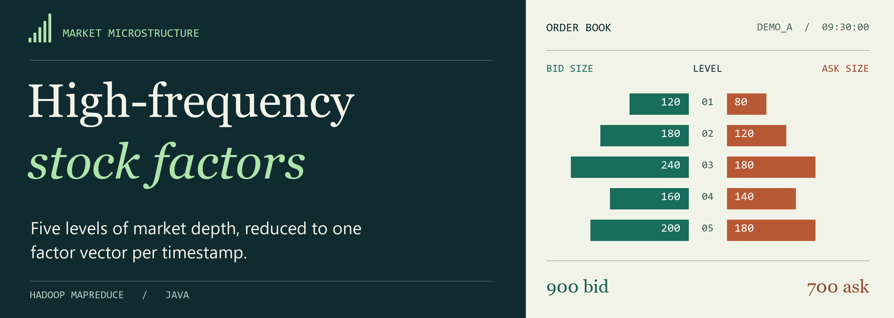
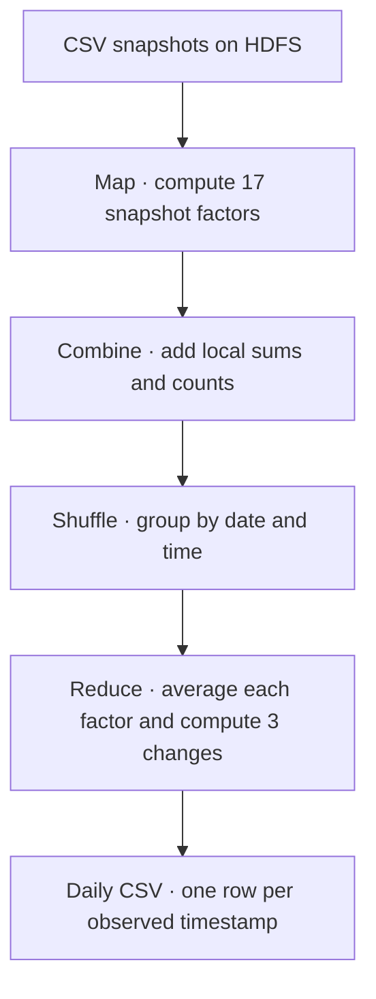

**How much buying pressure is visible across a basket of stocks at 09:30:00?** This Java batch job reads high-frequency equity snapshots, measures each stock’s five best bid and ask levels, and uses Hadoop MapReduce to produce 20 market-wide factors at each observed timestamp. The original course study used CSI 300 market data. The small example below uses synthetic quotes you can run yourself.

[Worked example](#from-quotes-to-factors) · [Architecture](#inside-the-mapreduce-job) · [Run the example](#run-the-example) · [Course results](#course-results)

## From quotes to factors

The cover shows the first snapshot for stock A. Buyers have posted 900 units across five levels, while sellers have posted 700. Its five-level depth imbalance is therefore `(900 − 700) / (900 + 700) = 0.125`. Stock B has equal depth on both sides. At the same timestamp, the reducer averages their factor values.

| At 09:30:00 | Best bid | Best ask | Spread · α1 | Midprice · α3 | Depth imbalance · α5 |
|---|---:|---:|---:|---:|---:|
| Stock A | 100.00 | 100.04 | 0.04 | 100.020 | 0.1250 |
| Stock B | 50.00 | 50.02 | 0.02 | 50.010 | 0.0000 |
| **Output mean** | | | **0.03** | **75.015** | **0.0625** |

Three seconds later, the mean midprice is **75.030**. The reducer carries the previous mean forward, so it writes **0.015** for the midprice change (α18). Both rows, including all 20 factors, are available in the [actual job output](examples/0106.csv). Inspect the [four input snapshots](examples/snapshots.csv) to follow the arithmetic.

<details>
<summary><strong>Explore the 20 output factors</strong></summary>

| Columns | Measures, in output order |
|---|---|
| α1–α3 | Best spread, spread divided by midprice, midprice |
| α4–α5 | Normalized bid–ask volume imbalance at the best level and across five levels |
| α6–α9 | Five-level bid depth, ask depth, depth difference, bid-to-ask depth ratio |
| α10 | Normalized imbalance of the feed’s total bid and ask volumes |
| α11–α14 | Volume-weighted bid price, volume-weighted ask price, pooled volume-weighted price, weighted ask minus weighted bid |
| α15–α16 | Mean bid depth minus mean ask depth per level, normalized imbalance with inverse-level volume weights |
| α17–α19 | Changes in mean best ask, mean midprice, and mean depth ratio since the previous observed timestamp that day |
| α20 | Best spread divided by combined five-level depth |

The snapshot formulas live in [FactorCalculator](src/main/java/util/FactorCalculator.java). The [reducer](src/main/java/job1/FactorReducer.java) computes the three changes after aggregation.

</details>

## Inside the MapReduce job



**Why carry counts?** A mapper can see many more quotes than its neighbor. Adding sums and counts before division gives every input row equal weight, even when map tasks process different numbers of rows. Hadoop can apply the [combiner](src/main/java/reducer/FactorCombiner.java) before sending partial results across the network.

**Why one reducer?** The three change factors need the preceding timestamp. A single reducer visits timestamps in order and resets its state at the start of each date. This keeps cross-time logic simple and limits final-stage parallelism. If the set of stocks changes between timestamps, its composition can also affect the change in the mean.

## Run the example

From the repository root, use Maven, a JDK with Java 8 target support, and a Hadoop 3.4.1 installation with HDFS and Snappy. The bundled configuration expects the NameNode at `hdfs://localhost:9000`. If your cluster uses a different URI, set it in [core-site.xml](src/main/resources/core-site.xml) before packaging and configure your HDFS CLI to use the same filesystem.

```bash
mvn package
hdfs dfs -mkdir -p factors-demo/input
hdfs dfs -put -f examples/snapshots.csv factors-demo/input/
hadoop jar target/Project-1.0-SNAPSHOT.jar driver.MainDriver factors-demo/input factors-demo/output
hdfs dfs -cat factors-demo/output/0106.csv
```

Use a fresh output directory for each run. The driver writes `MMDD.csv` with a `tradeTime` column followed by `alpha_1` through `alpha_20`. It reads records from 09:29:50 through 15:00:00 inclusive and starts writing at 09:30:00, so a pre-open observation can supply the previous value for the first published change.

For other inputs, preserve the [sample’s positional CSV layout](examples/snapshots.csv), including the field after level five. The parser reads five bid-price, bid-size, ask-price, ask-size groups and uses the comma after the last size as its delimiter.

## Course results

In the original pseudo-distributed Docker experiment, the full-sort baseline sent **7.2 million detail records** into the shuffle and took **more than 100 seconds** end to end. The final single-job design finished in **24 seconds** in that environment. These figures come from the course evaluation. The four-row example above demonstrates correctness on a small input. [Technical report, §6.1 (PDF, Chinese)](docs/report.pdf)

[Assignment brief (PDF)](docs/assignment.pdf) · [Architecture slides (PowerPoint, Chinese)](docs/高频数据量化因子分布式计算架构.pptx) · [Job configuration and CSV writer](src/main/java/driver/MainDriver.java)
